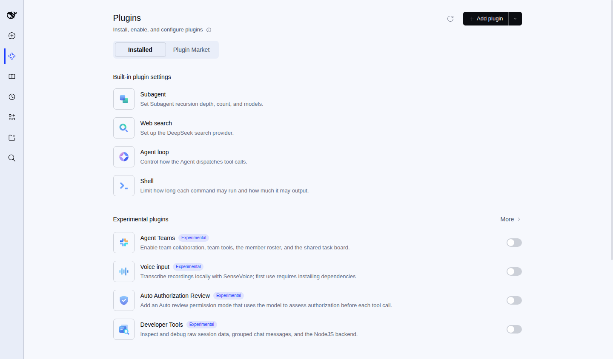
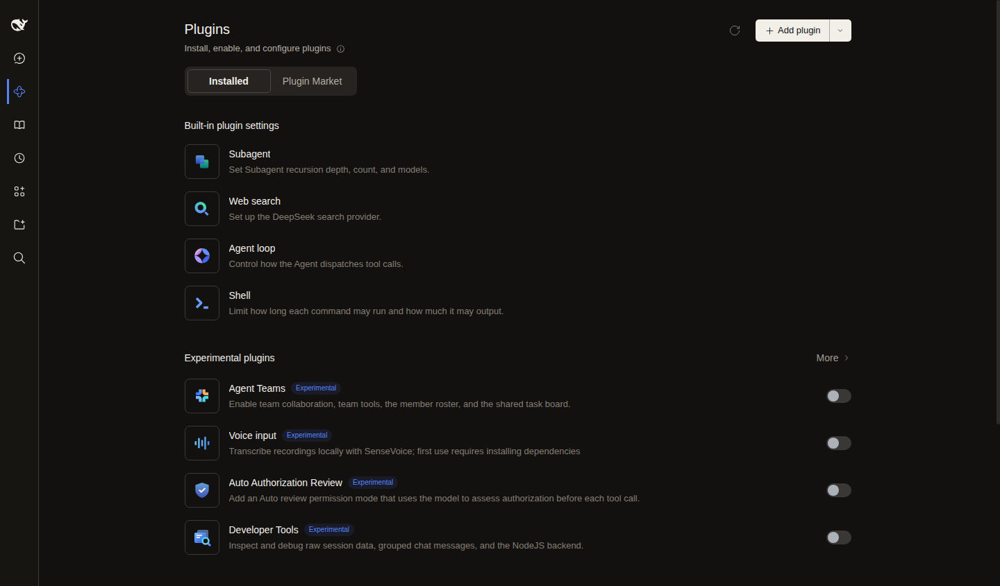
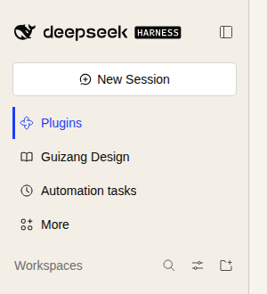

English | [中文](README.md)

# dsh-signal-blue-theme

A Swiss-style colour theme for [dsh](https://github.com/deepseek-ai/deepseek-harness), codenamed **Signal Blue** (`#1B3BFF`).

Swiss Style keeps its skeleton fixed: paper, ink and four neutral greys carry every level of hierarchy, leaving exactly one slot for an accent colour. Signal Blue takes that slot. It reads like current, not like a light source — and it only shows up where something needs to be said.

This repository is two things at once: **an installable DSH theme plugin**, and **a spec page that explains the palette**.

## Screenshots

Light — cold paper with a pale blue sidebar (1440 wide, sidebar collapsed):



Dark sits on a **deep navy night**, not black. The base `#0F1A35` and the accent share the same hue (265.9°), so the dark build is still Signal Blue — just after sunset. Links brighten to `#7AA3FF` to stay above 4.5:1 on that base.



The current sidebar item is marked by a 3px square blue bar and blue text — the same treatment as the interface sketch on the spec page:



## Versions

| Tag | Codename | Light | Dark |
|---|---|---|---|
| `v1.1.0` | Cool Paper | `#F6F8FD` / sidebar `#E8EDF8` | `#0F1A35` |
| `v1.0.0` | Warm Paper | `#F7F4ED` / sidebar `#F4EFE6` | `#0F1A35` |

See [CHANGELOG.md](CHANGELOG.md) for the details.

## Install

```sh
dsh plugin --profile web add /path/to/dsh-signal-blue-theme
```

Or straight from the repository:

```sh
dsh plugin --profile web add "github:rockyzhz/dsh-signal-blue-theme"
```

Refresh the page and the theme is live — no restart. To remove it:

```sh
dsh plugin --profile web remove dsh-signal-blue-theme
```

There is no on/off switch in the UI: while the plugin is installed the palette is on, remove it and everything returns to the stock theme. Light/dark is still controlled by Settings → General → Appearance; the theme and the colour scheme are two independent axes.

## What it changes

The plugin goes through the official `ThemeRuntime` by calling `ctx.theme.overrideTokens()`, stacking a token layer on top of the stock theme:

1. **Brand ramp** — all ten steps of `--dsw-static-deepseek-*` are replaced with the Signal Blue ramp. Nearly every official alias is a reference like `var(--dsw-static-deepseek-500)`, so changing the ramp moves links, button fills and business-state colours as one family.
2. **Literal aliases** — paper, ink, borders, code surfaces and the sidebar have to be set one by one; they are hard-coded in the official stylesheets and don't follow the ramp.
3. **Surface layer** (an extra injected stylesheet) — corners cut from 4–28px to 2–12px, card shadows replaced by a hairline, an Inter-first font stack, and the focus ring plus the current-item marker (`aria-current="page"`) recoloured to Signal Blue.

Steps 1–2 run through `overrideTokens`; step 3 is a `<style>` the plugin injects and removes on unload.

The ramps are rebuilt in OKLCH: hue fixed at 265.9°, lightness stepped, chroma tapered toward both ends, and gamut-mapped into sRGB. Measured WCAG 2.1:

| Pair | Ratio |
|---|---|
| 500 `#1b3bff` on paper `#f6f8fd` | 6.34:1 |
| White on 500 | 6.74:1 |
| 400 `#7aa3ff` on the dark base `#0f1a35` | 6.98:1 |

60 tokens are overridden in total, each verified to exist in the official stylesheet — an unknown name would be silently ignored.

## Palette

What the plugin actually ships:

| Token | Light | Dark | Used for |
|---|---|---|---|
| Paper | `#F6F8FD` | `#0F1A35` | Main surface |
| Sidebar | `#E8EDF8` | `#0B142D` | Sidebar, platform base |
| Ink | `#0B0D12` | `#E8ECF8` | Headings and body |
| Secondary | `#4A5160` | `#A8B0CC` | Secondary, meta |
| Signal Blue | `#1B3BFF` | `#7AA3FF` | Links, numbering, selection, status |

The spec page (`dsh-signal-blue.html`) uses the same accent but a lighter paper (`#FAFAF8`) — that page is a static document and wants to sit closer to white.

Paper and greys keep the Swiss skeleton; only the accent is new.

## Files

| File | What it is |
|---|---|
| `package.json` | Plugin manifest: `dsh.bundle.patch` + `dsh.client` |
| `cordis.patch.yml` | Inserts one row into the profile's config tree |
| `index.js` | Host half, no behaviour |
| `client.js` | Browser half, where the work happens |
| `icon.svg` | Plugin icon |
| `dsh-signal-blue.html` | The spec page, single file, open it in a browser |
| `dsh-signal-blue.png` | Full-page render of the same page, 1440 × 6878 |
| `index.md` | Spec page source (Markdown) |
| `make-annotations.mjs` | Builds the annotation file, including two inline SVG figures |
| `annotations.json` | Annotations used by the renderer (generated) |
| `build.mjs` | One command to rebuild the spec page |
| `README.en.md` | This file; [中文](README.md) is the default |
| `CHANGELOG.md` | Version and palette history |

## Rebuild the spec page

```bash
node build.mjs
```

The renderer comes from the Guizang Page skill; its path is hard-coded in the `SKILL` constant of `build.mjs` — change that line on another machine.

## License

MIT
